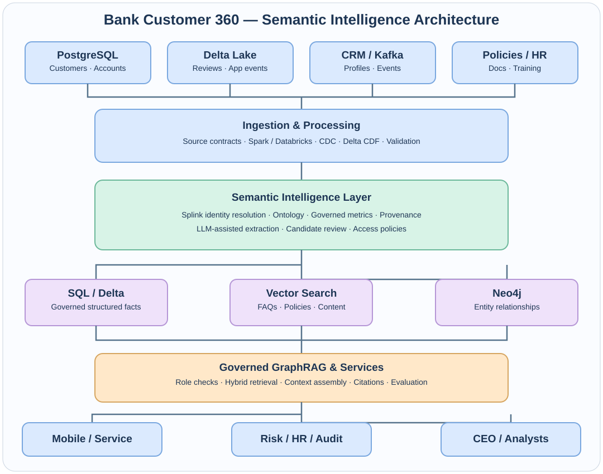
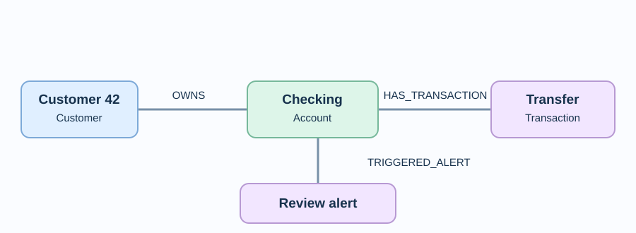

# Bank Semantic Intelligence Platform

**Customer 360 · Knowledge Graphs · Entity Resolution · Delta Lake · Governed GraphRAG · Enterprise Analytics**

A synthetic, teaching-first **banking semantic intelligence reference platform** with extensively documented Python modules, real executable offline workflows, optional Neo4j/Delta/Splink integrations, role-aware prompt examples, and an enterprise production roadmap. The design is original and uses no real banking customer data.



> **Implementation status:** The core local pipeline, graph snapshot, deterministic prompt routing, consent-filtered text extraction, lexical policy retrieval, governed metrics and unit tests run without external services. Neo4j, Splink, Delta Lake and a local LLM are optional integrations. PostgreSQL, Spark, Databricks, Kafka, production vector databases, CDC and enterprise authentication are described as target architecture rather than falsely claimed as complete.

## Quick start — Windows, Linux or macOS

```bash
# Python 3.10+; from the repository root
python -m venv .venv
# PowerShell: .venv\Scripts\Activate.ps1
# Linux/macOS: source .venv/bin/activate
python -m bank_semantic generate
python -m bank_semantic demo
python -m bank_semantic evaluate
python -m unittest discover -s tests -v
```

No API keys, cloud subscriptions or databases are needed for this baseline.

## What you will build



The project builds `Customer → OWNS → Account → HAS_TRANSACTION → Transaction → TRIGGERED_ALERT → FraudAlert` relationships from synthetic source records. It separately adds consented review-topic candidate relationships and synthetic mortgage-interest signals, preserving evidence and status. An alert is **not** proof of fraud; a review is **not** proof of identity or credit eligibility.

### Technologies and what is actually implemented

| Capability | Local implementation | Optional / enterprise path |
|---|---|---|
| Structured banking data | Generated CSV with relational IDs | PostgreSQL schema and future CDC connector |
| Unstructured review text | JSONL, deterministic extraction | Real Delta table, local LLM extractor |
| Entity resolution | Exact normalized email candidate links | Splink 4 + DuckDB probabilistic candidate scoring |
| Knowledge graph | JSON property graph with evidence | Neo4j Cypher loader |
| Document search | Lexical similarity + role classification | Embeddings + vector database + hybrid search |
| Semantic layer | Central governed KPI catalog | Versioned ontology and feature/metric registry |
| GraphRAG / prompt workflows | Deterministic authorized routing + cited results | LLM generation and multi-hop orchestration |
| Serving | CLI, optional local-only FastAPI | OIDC, policy engine, API gateway, observability |
| Data processing | Portable local pipeline | Databricks, Spark, Kafka, Delta CDF |
| Quality | 10 stdlib tests + retrieval recall@3 | Gold datasets, calibration, CI/CD, tracing |

## Example prompts for different bank teams

**CEO — mortgage partnership**
```bash
python -m bank_semantic ask --role executive --question "Should we explore a mortgage lender partnership?"
```
Counts only fabricated records with *both* mortgage-interest and contact-consent flags. Does not share customer identity or determine lending eligibility.

**HR — training compliance**
```bash
python -m bank_semantic ask --role hr --question "What is our employee training completion rate?"
```

**Risk — international alerts**
```bash
python -m bank_semantic ask --role fraud --question "What is the international alert rate?"
```

**Customer mobile app — own accounts**
```bash
python -m bank_semantic ask --role customer --customer-id 42 --question "Show my accounts"
```

**Customer service — policy answer**
```bash
python -m bank_semantic ask --role customer --customer-id 42 --question "How do I reset my mobile password?"
```

**Analyst — semantic KPIs**
```bash
python -m bank_semantic ask --role analyst --question "What are customer KPIs and transaction volume?"
```

More detailed scenarios: [Role-based use cases](docs/USE_CASES.md).

## Optional hands-on integrations

```bash
pip install '.[full]'
python -m bank_semantic delta-write
python -m bank_semantic demo --delta-path data/delta/reviews
python -m bank_semantic splink
```

Splink estimates match candidates, **not approved customer merges**. Its tiny training set is for learning and may require tuning or additional records depending on the installed version. The optional Splink path has not been end-to-end verified here.

### Neo4j

```bash
docker compose up -d neo4j
# Set BANK_NEO4J_PASSWORD to the Compose Neo4j password
python -m bank_semantic neo4j-load
```

Open Neo4j Browser at `http://localhost:7474`, then follow the [Cypher cookbook](docs/CYPHER.md). The sink upserts; deletion and consent revocation are production follow-up work.

### Local LLM extraction

Start a **trusted** local OpenAI-compatible chat server, then set:

```bash
# Bash example
export BANK_LLM_URL=http://127.0.0.1:1234/v1/chat/completions
export BANK_LLM_MODEL=your-loaded-model
python -m bank_semantic demo --mode llm
```

Only synthetic text is used. The model proposes relationship themes; output is schema/evidence checked and stays **unverified**. No untrusted LLM can execute SQL or Cypher through the assistant.

### Local API (demonstration only)

```bash
pip install '.[full]'
python -m bank_semantic generate
uvicorn bank_semantic.api:app --host 127.0.0.1 --port 8000
```

**Never expose the demo API publicly.** It uses a forgeable role header and has no authentication. A real bank requires verified identity and authorization before reading customer records.

## Repository map

```text
bank_semantic/
  synthetic.py      Synthetic source data generation
  ingest.py         CSV/JSONL/optional Delta readers
  identity.py       Exact linkage + optional Splink candidate scoring
  extract.py        Offline / optional LLM review-theme extraction
  graph.py          Property graph construction + evidence
  neo4j_sink.py     Neo4j idempotent upsert adapter
  vector.py         Transparent lexical document retrieval baseline
  semantic.py       Governed metric definitions
  assistant.py      Role-aware prompt routing and citations
  evaluate.py       Retrieval gold-set evaluation
  api.py            Local-only FastAPI example
  cli.py            Runnable command interface
sql/                PostgreSQL schema
assets/             Editable SVG architecture and graph diagrams
                              + supplied visual reference
 docs/               Tutorial, architecture, use cases, Cypher, ADRs, roadmap
 tests/              Automated regression and access-control tests
```

## Learning pathway

Read the [step-by-step tutorial](docs/TUTORIAL.md) and work through the modules in the order above. The [architecture explanation](docs/ARCHITECTURE.md) shows how semantic data connects to source systems, and the [production roadmap](docs/PRODUCTION.md) distinguishes implemented functionality from enterprise requirements.

## Privacy, safety and financial accuracy

- All records are synthetic. No real customer names, dates of birth, addresses, balances or credentials are required.
- DOB/email are generated in source fixtures for identity-learning purposes but intentionally excluded from the graph export.
- Customer reviews are used for extraction only when the fixture includes analytics consent.
- Fraud rule triggers and mortgage-interest signals are **not** legal, fraud or credit decisions.
- Metric definitions are centralized; monetary values use integer cents.
- The offline demo is not production-certified, and its local API is not safe for internet exposure.

## Project scope

The diagrams and domain use cases are original illustrative architecture. This repository is not affiliated with a particular bank, sports league, regulator, or vendor. See [ADRs](docs/ADRs/) for design decisions.

### Optional: real vector embeddings and Chroma

```bash
pip install 'chromadb>=0.5,<2' 'sentence-transformers>=3,<6'
python -c "from bank_semantic.vector_chroma import index_and_query; print(index_and_query('How do I reset my password?'))"
```

This adapter uses a real persistent Chroma vector index and local SentenceTransformer embeddings. First use may download model weights. Only public documents are returned in this illustrative query; production systems must apply the caller's verified identity and document ACLs.

### Optional: PostgreSQL fixture loading

```bash
docker compose up -d postgres
pip install 'psycopg[binary]>=3,<4'
# Set BANK_POSTGRES_DSN to a disposable local database connection string.
python -c "from bank_semantic.postgres_adapter import load_synthetic; from bank_semantic.config import DATA; print(load_synthetic(DATA))"
```

The PostgreSQL adapter loads generated rows into the Compose schema. The offline graph builder still reads CSV fixtures; direct PostgreSQL-to-graph CDC is a production extension.
"# Bank-Semantic-Intelligence" 
