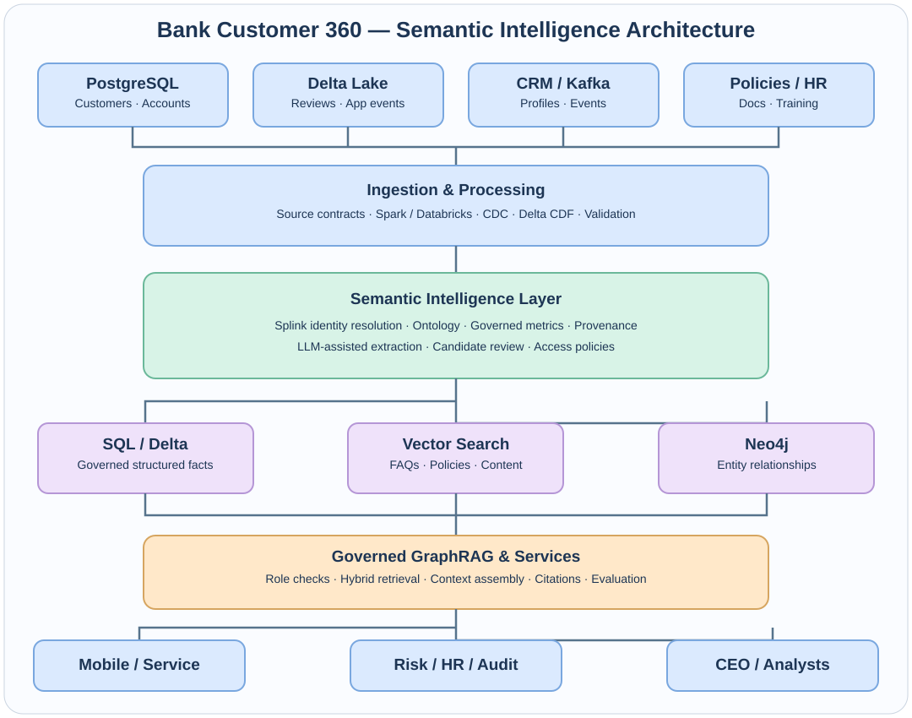

# Architecture and data contracts

## Data planes
1. **Source systems**: PostgreSQL banking tables, CRM identities, mobile events, review text, HR aggregate records and policy documents.
2. **Ingestion**: portable CSV/JSONL baseline, real Delta reader/writer option, planned Kafka/Spark/Databricks ingestion and CDC.
3. **Identity**: conservative email linkage baseline, optional Splink 4 probabilistic candidate generation. Never equate model probability with verified identity.
4. **Semantic intelligence**: versioned ontology, canonical IDs, governed KPI definitions and provenance.
5. **Stores**: graph snapshot/Neo4j, governed structured facts, FAQ document retrieval. Production vector index and hybrid retrieval are architectural extensions.
6. **Retrieval**: authorization -> intent routing -> source selection -> citations -> grounded answer. Local deterministic router; optional LLM used only for extraction.
7. **Serving**: local CLI and demo-only FastAPI facade. No production OIDC or policy enforcement point yet.

## Graph ontology
| Entity | Relationship | Entity | Meaning |
|---|---|---|---|
| Customer | OWNS | Account | Source FK |
| Account | HAS_TRANSACTION | Transaction | Source FK |
| Transaction | TRIGGERED_ALERT | FraudAlert | Rule trigger, not fraud verdict |
| Customer | INTEREST_SIGNAL | Product | Synthetic interest signal, not eligibility |
| Customer | AUTHORED_REVIEW_CANDIDATE | Review | Unverified association |
| Review | MENTIONS_CANDIDATE | Topic | Unverified text-derived claim |

**Never** infer a person's residential address, mortgage need, or credit eligibility solely from unstructured feedback. A real `LIVES_AT` relationship needs a verified address source, temporal validity, retention policy and authorization controls.

## Semantic consistency
`semantic.py` is the single metric catalog. For example `alert_rate` means distinct alerted transactions divided by total transactions in the same snapshot. Do not let an LLM improvise definitions.

## Trust boundaries
Review text is untrusted input. It may contain prompt injection. The extraction service must treat it as data, validate allowed output, require evidence, and retain a human-review path. Role scopes are demonstration only; the API accepts a caller-supplied role header and must NEVER be exposed publicly.
